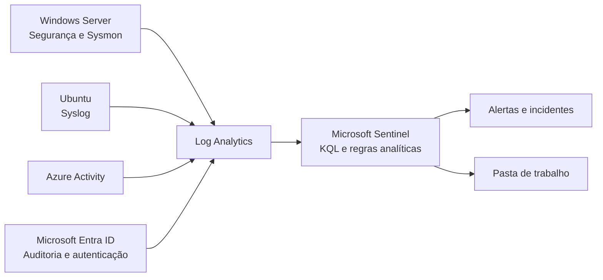

# Laboratório SOC no Azure — SC-200 🛡️

Laboratório prático de operações de segurança no Azure, com coleta de telemetria,
simulações controladas e detecções no Microsoft Sentinel para estudo da certificação
SC-200.

> [!NOTE]
> O laboratório foi concluído e o ambiente Azure foi removido ao final da execução.
> Este repositório reúne a configuração, os resultados e as evidências das atividades.

## Índice

- [Visão geral](#visão-geral)
- [Arquitetura e telemetria](#arquitetura-e-telemetria)
- [Simulações e detecções](#simulações-e-detecções)
- [Resultados registrados](#resultados-registrados)
- [Investigação e análise](#investigação-e-análise)
- [Como explorar o projeto](#como-explorar-o-projeto)
- [Estrutura do repositório](#estrutura-do-repositório)

## Visão geral

O projeto reúne a implantação e a operação de um ambiente SOC isolado, com uma
máquina Windows, uma máquina Linux e fontes de auditoria do Azure e do Microsoft
Entra ID. Os dados foram centralizados no Log Analytics e analisados no Microsoft
Sentinel com consultas KQL e regras analíticas.

O trabalho percorreu a configuração da coleta, a execução de simulações, a
validação de detecções e a análise de incidentes. Também inclui uma pasta de
trabalho para visualizar eventos, exercícios de phishing e hipóteses para futuras
buscas de ameaças.

**Tecnologias e referências:** Microsoft Sentinel, Log Analytics, Azure Monitor
Agent, Microsoft Entra ID, Sysmon, KQL e MITRE ATT&CK.

## Arquitetura e telemetria

O Sentinel foi habilitado em um workspace do Log Analytics dedicado ao laboratório.
Os endpoints enviavam eventos por meio do Azure Monitor Agent e de regras de coleta
de dados (DCRs); a atividade do Azure e do Entra ID chegava por configurações de
diagnóstico.

| Origem | Telemetria | Tabela no Log Analytics |
| --- | --- | --- |
| Azure | Atividade da assinatura e alterações de Azure RBAC | `AzureActivity` |
| Microsoft Entra ID | Auditoria do diretório e autenticações | `AuditLogs`, `SigninLogs` |
| Windows Server 2022 | Eventos de segurança, como logons e criação de processos | `SecurityEvent` |
| Sysmon no Windows | Processos e linhas de comando | `Event` |
| Ubuntu Server 24.04 LTS | Autenticação Linux e SSH | `Syslog` |

A [arquitetura](documentacao/architecture.md) detalha os recursos e as regras de
coleta. O [índice de diagramas](diagramas/README.md) apresenta os fluxos de
telemetria, detecção e resposta.

## Simulações e detecções

As simulações foram executadas em ambiente controlado para gerar sinais de
autenticação, execução, persistência e alterações de privilégios. As oito regras
analíticas abaixo foram testadas e validadas no Azure durante o laboratório.

| Comportamento | Regra analítica | Técnica ATT&CK no export |
| --- | --- | --- |
| Falhas SSH com usuário inexistente | [Força bruta SSH](deteccoes/regras-analiticas/brute-force-ssh.md) | T1110 |
| Falhas de logon RDP | [Força bruta RDP](deteccoes/regras-analiticas/brute-force-windows.md) | T1110 |
| Falhas de autenticação no Entra ID | [Falhas de entrada no Entra ID](deteccoes/regras-analiticas/entra-failed-signins.md) | T1110 |
| Atribuição de função Azure RBAC | [Alteração de função Azure RBAC](deteccoes/regras-analiticas/azure-rbac-role-assignment.md) | T1098 |
| Atribuição de função privilegiada no Entra ID | [Alteração de função no Entra ID](deteccoes/regras-analiticas/privileged-role-change.md) | T1098 |
| Criação de tarefa agendada | [Tarefa agendada](deteccoes/regras-analiticas/scheduled-task-creation.md) | T1053 |
| PowerShell com comando codificado | [PowerShell codificado](deteccoes/regras-analiticas/encoded-powershell.md) | T1059 |
| Criação de conta local | [Conta local](deteccoes/regras-analiticas/local-account-creation.md) | T1136 |

No export, as regras estão habilitadas, têm severidade Medium e frequência de
execução de cinco minutos. Os períodos de consulta e os agrupamentos variam; os
limiares de eventos estão nas consultas KQL. As regras de SSH, RDP e falhas no
Entra ID incluem mapeamentos de entidades.

Consulte as [simulações](simulacoes/README.md), o [catálogo KQL](deteccoes/consultas-kql/README.md)
e a [cobertura MITRE ATT&CK](documentacao/mitre-coverage.md). Algumas simulações
descrevem subtécnicas mais específicas do que as técnicas principais no export.

## Resultados registrados

- **Validação RDP:** uma consulta encontrou sete falhas de logon em cerca de
  23 segundos; um incidente reuniu seis alertas agrupados e apresentou as entidades
  IP e Host.
- **Pasta de trabalho:** em uma janela de 30 dias, foram registrados 18 eventos
  de falha SSH, 12 de RDP e 7 do Entra ID.
- **Coleta de processos:** a política de linha de comando do evento Windows 4688
  foi habilitada para enriquecer a telemetria de criação de processos.
- **Tarefa agendada:** a criação foi observada no evento 4688 e confirmada por
  consulta local à tarefa.

O [registro do laboratório](documentacao/lab-build-record.md) reúne a implantação
e os resultados observados. O [diário de simulações](documentacao/attack-journal.md)
documenta os horários e os sinais observados, e a
[pasta de trabalho](pastas-de-trabalho/soc-dashboard.md) detalha os painéis.

## Investigação e análise

- **Incidentes:** o caso RDP registra a identificação e a severidade do incidente,
  além das entidades observadas. O agrupamento de alertas reduziu a duplicação de
  incidentes.
- **Busca de ameaças:** as [hipóteses de investigação](caca-ameacas/README.md)
  apresentam cenários para investigar comprometimento de contas, persistência por
  tarefa agendada e uso suspeito de PowerShell.
- **Phishing:** dois [casos sintéticos](phishing/README.md) exercitam a triagem
  de uma mensagem de coleta de credenciais e de uma fraude de fornecedor. O
  [script de análise](scripts/README.md) processa arquivos `.eml` sem executar
  seu conteúdo.
- **Automação:** o [fluxo de resposta a incidentes](diagramas/incident-response-flow.png)
  apresenta uma referência visual para a investigação e o tratamento de incidentes.

## Como explorar o projeto

1. Comece pelo [registro da implantação](documentacao/lab-build-record.md) e pela
   [arquitetura](documentacao/architecture.md) para entender o ambiente e as fontes.
2. Relacione o [diário de simulações](documentacao/attack-journal.md) às
   [regras analíticas](deteccoes/regras-analiticas/README.md) e às consultas KQL.
3. Examine os [resultados da pasta de trabalho](pastas-de-trabalho/soc-dashboard.md)
   e as [evidências selecionadas](evidencias/README.md).
4. Consulte as [lições aprendidas](documentacao/lessons-learned.md) e os exercícios
   de [phishing](phishing/README.md) para complementar a investigação.

A [configuração do laboratório](documentacao/lab-setup.md) apresenta a sequência
de implantação como referência para recriar o ambiente em recursos autorizados e
isolados. O
[export ARM das regras](deteccoes/regras-analiticas/azure-sentinel-analytics-rules.json)
é parametrizado e requer um workspace. Antes de usá-lo, consulte a referência
adotada para a regra RDP no [registro da implantação](documentacao/lab-build-record.md)
e valide as consultas e os campos no ambiente de destino.

## Estrutura do repositório

| Área | Conteúdo |
| --- | --- |
| [Documentação](documentacao/README.md) | Arquitetura, implantação, custos, solução de problemas e lições |
| [Infraestrutura](infraestrutura/README.md) | Configuração da rede, dos endpoints, do Entra ID e do Sentinel |
| [Simulações](simulacoes/README.md) | Exercícios controlados e sinais esperados |
| [Detecções](deteccoes/README.md) | Consultas KQL, regras analíticas e ajustes |
| [Busca de ameaças](caca-ameacas/README.md) | Hipóteses e consultas de referência |
| [Phishing](phishing/README.md) | Análises de duas mensagens sintéticas |
| [Pastas de trabalho](pastas-de-trabalho/README.md) | Painéis e resultados registrados |
| [Diagramas](diagramas/README.md) | Representações da arquitetura e dos fluxos |
| [Evidências](evidencias/README.md) | Capturas selecionadas e organizadas por fase |
| [Scripts](scripts/README.md) | Triagem estática de mensagens `.eml` |
